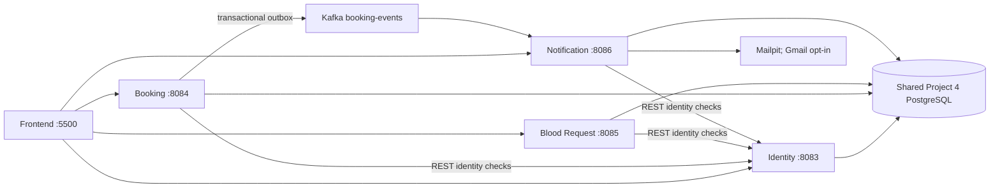
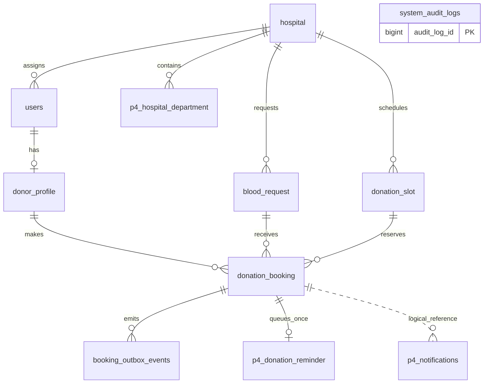

# Healthcare Support System

## Project 4 — current delivery version

The `feature/project4-microservices` branch runs Identity, Booking, Blood Request
and Notification as separate Dockerized services with PostgreSQL, Kafka, a
transactional outbox, Cucumber checks and a GitHub Actions image pipeline.
See the [Project 4 runbook](runtime/project4/README.md) for architecture, API docs,
configuration, testing, manual activation and remaining deployment work.
The Project 2/3 documentation below is retained as historical context.

## Project Description

Healthcare Support System is a backend application designed to connect individuals who want to support the healthcare sector with hospitals and healthcare organizations that need community assistance.

The first version of the platform focuses on blood donation. Hospitals can publish blood requests, while donors can view relevant requests and book donation appointments.

The system is designed to be scalable, allowing future versions to include additional healthcare support services such as medical equipment donation, patient companion services, transportation assistance and other volunteer opportunities.

## Problem Statement

Hospitals and healthcare organizations may face situations where community support is needed, but there is often no centralized system that connects them directly with individuals who are willing to help.

For blood donation specifically, hospitals may need particular blood types within a certain period, while potential donors may not easily know where or when their blood type is needed.

Healthcare Support System aims to provide a centralized platform where healthcare organizations can publish their support needs and community members can find suitable opportunities and respond through an organized process.


## Project Purpose

The purpose of Healthcare Support System is to create a secure and organized platform that makes it easier for individuals to support healthcare organizations.

In the first version, the system focuses on improving the blood donation process by allowing hospitals to publish blood requests and donors to discover these requests and book suitable donation appointments.

The project also aims to provide a strong foundation that can be expanded in the future to support additional healthcare and volunteering services.


## Target Users and Roles

The Healthcare Support System supports three main user roles:

### Donor
A donor is a registered user who wants to support healthcare organizations through blood donation. Donors can manage their profiles, view available blood requests, search for suitable requests, and book or cancel donation appointments.

### Hospital Staff
Hospital staff are authorized users associated with a hospital or healthcare organization. They can create and manage blood requests, view donation bookings, and update booking statuses.

### Admin
The admin manages the overall platform. Admins can manage users and hospitals, deactivate accounts when necessary, and monitor the system.

## Version 1 Scope

The first version of the Healthcare Support System focuses on blood donation support and appointment booking.

## Technologies Used

- **Java 17** - Main programming language.
- **Spring Boot 4.1.1** - Backend application framework.
- **Spring Web MVC** - REST API development.
- **Spring Data JPA** - Database access and persistence.
- **PostgreSQL** - Relational database management system.
- **Spring Security** - Authentication and role-based authorization.
- **JWT (JJWT 0.12.6)** - Token-based authentication.
- **Spring Validation** - Request data validation.
- **Spring Mail** - Email verification and password recovery emails.
- **Spring WebSocket** - Real-time booking notifications.
- **Swagger / OpenAPI** - Interactive API documentation.
- **Lombok** - Reduction of repetitive Java code.
- **Maven** - Dependency management and project build.
- **JUnit / Spring Security Test** - Automated testing.

## General Approach

The Healthcare Support System was developed using a layered backend architecture to keep the application organized, maintainable, and scalable.

The development process started with defining the project scope, user roles, database entities, and relationships. The backend was then implemented using Spring Boot with separate controller, service, repository, model, security, and exception layers.

REST APIs were developed for authentication, user profiles, hospitals, blood requests, and donation bookings. Business rules and validation were implemented in the service layer, while Spring Security and JWT were used to protect endpoints and enforce role-based access.

PostgreSQL is used for persistent data storage, Swagger/OpenAPI is used for API documentation and testing, and automated tests are used to verify important business rules and security behavior.

## User Stories

User stories were created to represent the main requirements of the Healthcare Support System from the perspective of Donors, Hospital Staff, and Admins.

The user stories cover the main system functionality, including user registration, login, email verification, password management, profile management, blood requests, donation bookings, booking status management, cancellation, and administration.

The complete user stories and their development progress are managed in the project Jira board:

https://thajbakmohamed.atlassian.net/jira/software/projects/KAN/boards/2

## Project Planning

The Healthcare Support System was planned and tracked using Jira.

The Jira board was used to organize the project into Epics, Tasks, and User Stories, track development progress, and manage project deadlines using due dates.

Project planning board:

https://thajbakmohamed.atlassian.net/jira/software/projects/KAN/boards/2


### In Scope

- User registration and secure login.
- Email verification.
- Role-based access for Donors, Hospital Staff, and Admins.
- User and donor profile management.
- Profile picture and CPR image upload.
- Hospital management.
- Blood request creation and management.
- Search and filtering of blood requests.
- Donation appointment booking.
- Booking availability management.
- Prevention of conflicting or duplicate bookings.
- Booking cancellation and status updates.
- Email notifications.
- Real-time booking notifications.
- Soft deletion and account deactivation.
- Secure REST API using JWT authentication.
- API documentation using Swagger/OpenAPI.

### Out of Scope for Version 1

The following features are planned for future versions:

- Medical equipment donation and lending.
- Patient companion services.
- Transportation assistance.
- Translation and digital assistance.
- General healthcare volunteering opportunities.
- Volunteer hour tracking and certificates.
- Mobile application.
- SMS notifications.
- Map and location services.
- Advanced analytics and dashboards.

## Database ERD

The following Entity Relationship Diagram represents the database design for the Healthcare Support System.


## Project Architecture

The Healthcare Support System follows a layered backend architecture using Java and Spring Boot.

The project is organized into the following packages:

- **controller** - Handles HTTP requests and REST API endpoints.
- **service** - Contains business logic and system rules.
- **repository** - Handles database operations using Spring Data JPA.
- **model** - Contains the system entities and database models.
- **dataTransferObject** - Contains request and response objects used to transfer data between the client and the application.
- **security** - Handles authentication, authorization, and JWT security.
- **exception** - Handles custom exceptions and global error handling.
- **config** - Contains application and security configuration.


### Package Structure

```text
com.app.med_support
│
├── controller
├── service
├── repository
├── model
├── dataTransferObject
│   ├── request
│   └── response
├── security
├── exception
└── config
```

### Application Flow

```text
Client / Postman
        ↓
Controller
        ↓
Data Transfer Object + Validation
        ↓
Service
        ↓
Business Rules
        ↓
Repository
        ↓
PostgreSQL
```


### Application Flow

```text
Client / Postman
        ↓
Controller
        ↓
Data Transfer Object + Validation
        ↓
Service
        ↓
Business Rules
        ↓
Repository
        ↓
PostgreSQL
```
## API Documentation

The REST API is documented and can be tested interactively using Swagger/OpenAPI.

### Authentication Endpoints

| Method | Endpoint | Description | Access |
|---|---|---|---|
| POST | `/api/auth/register` | Register a new DONOR or HOSPITAL_STAFF account and send an email verification link | Public |
| GET | `/api/auth/verify-email?token={token}` | Verify a user's email using the verification token | Public |
| POST | `/api/auth/login` | Authenticate a verified user and return a JWT token | Public |
| POST | `/api/auth/forgot-password?email={email}` | Send a password reset link to the registered email | Public |
| POST | `/api/auth/reset-password` | Reset the user's password using a valid reset token | Public |
| PUT | `/api/auth/change-password` | Change the password of the authenticated user | Authenticated User |

### User Profile Endpoints

| Method | Endpoint | Description | Access |
|---|---|---|---|
| PUT | `/api/users/profile` | Update the authenticated user's profile information | Authenticated User |
| POST | `/api/users/profile/cpr` | Upload a CPR document in PDF, JPEG, or PNG format | Authenticated User |
| POST | `/api/users/profile/image` | Upload a profile image in JPEG or PNG format | Authenticated User |
| DELETE | `/api/users/profile` | Soft delete the authenticated user's account by changing its status to INACTIVE | Authenticated User |

### Hospital Endpoints

| Method | Endpoint | Description | Access |
|---|---|---|---|
| GET | `/api/hospitals` | Retrieve all hospitals available in the Med Support system | Authenticated User |
| GET | `/api/hospitals/{hospitalId}` | Retrieve a specific hospital by its ID | Authenticated User |

### Blood Request Endpoints

| Method | Endpoint | Description | Access |
|---|---|---|---|
| POST | `/api/blood-requests` | Create a blood request for the logged-in staff member's hospital | HOSPITAL_STAFF |
| GET | `/api/blood-requests?page={page}&size={size}&sortBy={field}&direction={asc/desc}` | Retrieve blood requests with pagination and sorting | ADMIN |
| GET | `/api/blood-requests/open` | Retrieve all blood requests with OPEN status | DONOR |
| GET | `/api/blood-requests/open/blood-type/{bloodType}` | Retrieve OPEN blood requests filtered by blood type | DONOR |
| GET | `/api/blood-requests/{bloodRequestId}` | Retrieve a specific blood request by ID | ADMIN / HOSPITAL_STAFF |
| PUT | `/api/blood-requests/{bloodRequestId}/status?newStatus={status}` | Update the status of a blood request belonging to the staff member's hospital | HOSPITAL_STAFF |
| GET | `/api/blood-requests/hospital` | Retrieve all blood requests belonging to the logged-in staff member's hospital | HOSPITAL_STAFF |

### Donation Booking Endpoints

| Method | Endpoint | Description | Access |
|---|---|---|---|
| POST | `/api/donation-bookings` | Create a donation booking for an OPEN blood request | DONOR |
| GET | `/api/donation-bookings/donor` | Retrieve all donation bookings belonging to the logged-in donor | DONOR |
| GET | `/api/donation-bookings/blood-request/{bloodRequestId}` | Retrieve donation bookings for a blood request belonging to the staff member's hospital | HOSPITAL_STAFF |
| PUT | `/api/donation-bookings/{bookingId}/status?newStatus={status}` | Update the status of a donation booking | HOSPITAL_STAFF |
| PUT | `/api/donation-bookings/{bookingId}/cancel` | Cancel one of the logged-in donor's eligible bookings | DONOR |

### Admin Endpoints

| Method | Endpoint | Description | Access |
|---|---|---|---|
| PUT | `/api/admin/users/{userId}/reactivate` | Reactivate an inactive user account | ADMIN |
| PUT | `/api/admin/users/{userId}/deactivate` | Deactivate a user account without permanently deleting it | ADMIN |
| POST | `/api/admin/hospitals` | Create a new hospital | ADMIN |
| PUT | `/api/admin/hospitals/{hospitalId}/deactivate` | Deactivate a hospital without permanently deleting it | ADMIN |
| PUT | `/api/admin/hospitals/{hospitalId}/reactivate` | Reactivate a previously deactivated hospital | ADMIN |
| GET | `/api/admin/hospitals` | Retrieve all hospitals for administration | ADMIN |
| PUT | `/api/admin/hospitals/{hospitalId}` | Update an existing hospital's information | ADMIN |

### Swagger / OpenAPI

The Healthcare Support System provides interactive API documentation using Swagger/OpenAPI.

After running the application, the Swagger UI can be accessed at:

http://localhost:8080/swagger-ui/index.html

Swagger can be used to:
- View available API endpoints.
- Review request parameters and request bodies.
- View documented HTTP response codes.
- Test API endpoints.
- Authenticate protected endpoints using a JWT Bearer token.

## Installation and Setup

### Prerequisites

Before running the project, make sure the following are installed:

- Java 17
- PostgreSQL
- Maven or Maven Wrapper
- IntelliJ IDEA or another Java IDE

### 1. Clone the Repository

```bash
git clone https://github.com/thajbakmohamed-ctrl/med-support-app.git
cd med-support-app
```

### 2. Create the PostgreSQL Database

Create a PostgreSQL database named:

```text
med_support
```


### 3. Configure Environment Variables

The application uses environment variables to protect sensitive information.

Configure the following variables:

```text
DB_PASSWORD=your_postgresql_password
MAIL_USERNAME=your_email_address
MAIL_PASSWORD=your_email_app_password
JWT_SECRET=your_jwt_secret
```

### 4. Start the Application

From the repository root, run `.\mvnw.cmd spring-boot:run` on Windows or
`./mvnw spring-boot:run` on macOS or Linux.


```text
http://localhost:8080
```

### 5. Access Swagger

After the application starts, open:

```text
http://localhost:8080/swagger-ui/index.html
```

Swagger can be used to explore and test the available REST API endpoints.

## Challenges

During the development of the Healthcare Support System, several challenges were encountered:

- Implementing JWT authentication and role-based authorization for different user roles.
- Managing email verification and secure password recovery.
- Applying booking business rules to prevent duplicate or conflicting donation appointments.
- Restricting hospital staff operations to their assigned hospital.
- Implementing secure file uploads with file type and size validation.
- Implementing pagination, sorting, filtering, and rate limiting.
- Integrating real-time booking notifications using WebSocket.
- Designing automated tests for business rules and security behavior.

These challenges were addressed during development through testing, validation, exception handling, and improvements to the application architecture.


## Unsolved Problems

There are currently no known critical unresolved issues in Version 1 of the Healthcare Support System.

Future development may reveal additional improvements or issues as new features are introduced and the system is expanded.

## Future Improvements

Future versions of the Healthcare Support System may include:

- Medical equipment donation and lending.
- Patient companion and support services.
- Transportation assistance for patients.
- Translation and digital assistance services.
- General healthcare volunteering opportunities.
- Volunteer hour tracking and certificates.
- Mobile application support.
- SMS notifications.
- Map and location services.
- Advanced analytics and dashboards.


## Credits and External Resources

The following resources were used during the development of this project:

- **General Assembly Java Developer Bootcamp Materials**  
  Used as learning and reference materials for Java, Spring Boot, REST APIs, database integration, and backend development.

- **Project Requirements and README provided by the instructor**  
  Used as the main reference for the project requirements, required backend concepts, documentation structure, and project deliverables.

- **Spring Boot and Spring Security**  
  Used for developing the REST API, authentication, authorization, and application security.

- **Swagger / OpenAPI**  
  Used to document and test the REST API endpoints.

- **Jira**  
  Used for project planning, Epics, Tasks, User Stories, development tracking, and deadlines.

### General Assembly - RESTful JSON API with Java Spring Boot

**Resource:** General Assembly Java Spring Boot Lesson   
**URL:** https://github.com/Java-FT-01-Bahrain/JDB-Info/blob/e244b561ff864fc267b1bfbef8e087c0f67afef2/Lessons/JavaSpringBoot/Java-Spring-Boot-lecture/README.md

This lesson was used as a learning and reference resource for Spring Boot REST APIs, Spring Profiles, Spring Data JPA, PostgreSQL integration, layered architecture, authentication, Spring Security, and JWT implementation.

### Spring Framework - WebSocket and STOMP

**Resource:** Spring Guide - Using WebSocket to Build an Interactive Web Application  
**URL:** https://spring.io/guides/gs/messaging-stomp-websocket/

Used as a reference for implementing real-time notifications using WebSocket and STOMP messaging.

### Spring Security

**Resource:** Spring Security Documentation  
**URL:** https://docs.spring.io/spring-security/reference/

Used as a reference for authentication, password encryption, endpoint protection, and role-based authorization in the application.

### Swagger / OpenAPI

**Resource:** Springdoc OpenAPI Documentation  
**URL:** https://springdoc.org/

Used as a reference for documenting and testing REST API endpoints through Swagger UI.


# Project 3 — Concurrency & Multithreading

## Project Overview

Project 3 is an extension of the Med Support Blood Donation Management System developed in Project 2.

The main goal of Project 3 is to improve the application's ability to handle multiple operations happening at the same time while maintaining data consistency and preventing booking conflicts.

In this phase, I introduced donation slots with limited capacity, implemented database locking to prevent race conditions, and added background processing using Java multithreading and ExecutorService.

The project also includes automated donation reminders, asynchronous email processing, improved booking management, and automatic blood request completion.

These improvements allow Med Support to manage simultaneous donation bookings more safely while providing a better experience for donors and hospital staff.

## Project 3 Objectives

- Prevent overbooking when multiple donors try to reserve the same donation slot.
- Prevent conflicting bookings for the same donor.
- Protect shared database records using pessimistic locking.
- Maintain database consistency using transactions.
- Use ExecutorService and a thread pool to process background tasks.
- Send booking-related emails asynchronously.
- Process scheduled donation reminders.
- Automatically complete blood requests when the required number of donations is fulfilled.
- Extend booking notifications and hospital request history.
- Test concurrent operations to verify that shared resources are handled safely.


## New Features Introduced in Project 3

Project 3 extends the existing Med Support application with new functionality focused on concurrency, thread safety, and background processing.

The main improvements include:

1. **Donation Slot Management:** Hospital staff can create and manage donation slots with limited capacity. Donors can select available slots when booking appointments.

2. **Concurrency-Safe Booking:** The application uses database locking and transactions to prevent overbooking when multiple donors attempt to reserve the same slot simultaneously.

3. **Duplicate Booking Prevention:** Donor profile locking helps prevent conflicting bookings created by simultaneous requests from the same donor.

4. **Donation Reminders:** Donors can schedule reminders for their upcoming appointments. A scheduled process identifies reminders that are due and submits them for processing.

5. **Asynchronous Processing:** An ExecutorService with a fixed thread pool of three workers processes reminder tasks and booking-related email tasks.

6. **Automatic Blood Request Completion:** When the number of completed donations reaches the required number of blood units, the blood request automatically changes to COMPLETED.

7. **Improved Booking Notifications:** Booking status updates are saved as notifications and delivered through WebSocket after successful database transactions.

8. **Hospital Request History:** Hospital staff can view all blood requests in General History and fully completed requests in Completed History.

## New Database Entities

Three new JPA entities were added during Project 3.

### 1. DonationSlot

The `DonationSlot` entity represents an appointment slot created by a hospital.

It stores the date, start time, end time, capacity, and number of reserved places.

The system uses this entity to control appointment availability and prevent overbooking.

A donation slot is associated with a hospital and can be linked to multiple donation bookings.

### 2. DonationReminder

The `DonationReminder` entity represents a reminder associated with a donation booking.

It allows the application to track scheduled reminders and their processing status.

The reminder workflow uses the following states:

- `PENDING` — Waiting to be processed.
- `PROCESSING` — Claimed by a background worker.
- `SENT` — Reminder notification processing completed.
- `FAILED` — Reminder processing failed.

A scheduled task checks for due reminders and submits them to the ExecutorService for processing.

The updated database contains ten JPA entities in total.


### 3. HospitalDepartment

The `HospitalDepartment` entity was added to organize hospital departments within the Med Support system.

Each department belongs to one hospital, while a hospital can have multiple departments.

The entity contains the following fields:

- `id` — Unique department identifier.
- `departmentName` — Name of the department.
- `description` — Description of the department.
- `hospital` — Reference to the associated hospital.

The entity uses a Many-to-One relationship with the existing `Hospital` entity.

A simple REST API allows hospital staff to create departments for their own hospital. Donors and hospital staff can also retrieve departments belonging to a specific hospital.

This feature does not require additional concurrency logic or database locks.


## Concurrency and Race Condition Handling

### Business Scenario

In Med Support, multiple donors may attempt to book the same donation slot at the same time.

Each donation slot has a limited capacity. Without proper concurrency control, simultaneous booking requests could cause overbooking or inconsistent reservation counts.

### Race Condition Example

Consider a donation slot with a capacity of 1.

Two donors attempt to reserve the same slot simultaneously:

1. Donor A checks the slot and sees one available place.
2. Donor B checks the same slot before Donor A finishes booking.
3. Both donors attempt to reserve the last available place.

Without concurrency control, both requests might succeed even though only one place is available.

This situation is called a **Race Condition**, where the final result depends on the timing of concurrent operations.

### Solution: Pessimistic Database Locking

To prevent conflicting database operations, Med Support uses `PESSIMISTIC_WRITE` locking with Spring Data JPA.

The application locks the required database record while a transaction performs its checks and updates.

Other transactions requesting a conflicting lock on the same record must wait until the current transaction releases it.

### Four Database Locks

**1. Donor Profile Lock**

Protects the donor's profile during booking creation.

It prevents simultaneous requests from the same donor from creating conflicting bookings.

**2. Donation Slot Lock**

Protects the donation slot's capacity and reservation count.

It ensures that multiple donors cannot reserve more places than the slot allows.

**3. Donation Booking Lock**

Protects an existing donation booking while its status is being updated.

It helps prevent conflicting changes to the same booking.

**4. Blood Request Lock**

Protects the blood request during donation completion.

It allows the application to safely count completed donations and update the request status when the required blood units have been fulfilled.

### Transaction Management

Med Support uses Spring's `@Transactional` annotation to manage related database operations as a single transaction.

For example, when creating a donation booking:

1. The system locks the donor profile.
2. It checks for conflicting bookings.
3. It locks the selected donation slot.
4. It checks the remaining capacity.
5. It creates the donation booking.
6. It updates the slot's reservation count.
7. The transaction commits if all operations succeed.

If an error occurs, the transaction can roll back its database changes, helping prevent partial updates.

### Expected Concurrent Booking Result

For a donation slot with one available place:

- Donor A successfully books the slot.
- Donor B receives a conflict response if the slot becomes full.
- The final reservation count remains within the slot capacity.

This approach helps maintain database consistency and prevents overbooking when multiple booking requests are processed concurrently.


## Multithreading and Asynchronous Processing


### ExecutorService and Thread Pool

In Project 3, Med Support uses Java's **ExecutorService** to process background tasks asynchronously without blocking the main HTTP request.

The application uses a fixed thread pool of three worker threads, configured in `ReminderExecutorConfig.java`.

The thread pool is created using `Executors.newFixedThreadPool(3)`.

It processes booking-related emails and donation reminders in the background.

Instead of creating a new thread for every task, the application submits tasks to the ExecutorService, which assigns them to available worker threads.

If all three workers are busy, additional tasks wait in a queue until a worker becomes available.


### Asynchronous Booking Emails

When a donation booking is confirmed or cancelled, the application can send an email notification to the donor.

Sending an email may take time because it requires communication with an external mail server.

To avoid blocking the main request, the application submits email tasks to the ExecutorService.

The `afterCommit()` callback is used to ensure that email processing starts only after the related database transaction has committed successfully.

The workflow is:

1. Hospital staff confirms or cancels a donation booking.
2. The booking status is updated in the database.
3. The database transaction commits successfully.
4. The email task is submitted to the thread pool.
5. An available worker thread processes the email task.

This separates the database operation from the potentially slower email-sending process.

### Scheduled Donation Reminders

Project 3 introduces donation reminders for upcoming appointments.

Donors can schedule reminders for their donation bookings.

The application uses Spring's `@Scheduled` functionality to check for reminders that are due.

The scheduler runs every ten seconds and identifies pending reminders that should be processed.

Due reminders are submitted to the ExecutorService for background processing.

### Reminder Processing Workflow

Each reminder follows a processing lifecycle:

1. **PENDING:** The reminder is waiting for its scheduled time.
2. **PROCESSING:** A worker claims the reminder for processing.
3. **SENT:** The reminder notification has been processed successfully.
4. **FAILED:** Reminder processing failed.

To prevent multiple workers from processing the same reminder at the same time, the application uses an atomic database update to claim the reminder.

Only the worker that successfully changes the reminder status from `PENDING` to `PROCESSING` can continue processing it.

This protects the system from creating duplicate reminder notifications when concurrent workers attempt to process the same reminder.

### Why Multithreading Was Used

Multithreading improves Med Support by allowing background tasks to run independently of the main request-processing flow.

It provides the following benefits:

- Booking-related emails can be processed without blocking the main HTTP request.
- Multiple background tasks can execute concurrently.
- The number of worker threads is controlled through a fixed-size pool.
- Scheduled donation reminders can be processed automatically.
- Atomic reminder claiming helps prevent duplicate processing by concurrent workers.

The thread pool improves task execution, while database transactions and concurrency controls protect shared data.


## Automatic Blood Request Completion

Project 3 introduces automatic blood request completion based on the number of successfully completed donations.

Previously, blood requests required manual status management. The updated system can automatically change a blood request from `OPEN` to `COMPLETED` when the required blood units have been fulfilled.

### Business Rule

**One completed donation equals one blood unit.**

For example, if a hospital creates a blood request requiring two blood units:

1. Donor A completes a donation.
2. The system counts one completed donation.
3. The blood request remains `OPEN` because one more unit is required.
4. Donor B completes a donation.
5. The system counts two completed donations.
6. The blood request automatically changes to `COMPLETED`.

### Database Consistency

The application uses `@Transactional` and `PESSIMISTIC_WRITE` locking on the blood request when updating a booking's status.

When a booking becomes `COMPLETED`, the application:

1. Updates the donation booking status.
2. Flushes the updated booking to the database.
3. Counts bookings with `COMPLETED` status for the same blood request.
4. Compares the completed donation count with the required blood units.
5. Updates the blood request to `COMPLETED` when the required number is reached.

These operations are performed within a database transaction to help maintain consistency during concurrent updates.

### Example Tested

Blood Request #22 required two blood units.

Two donation bookings were updated through the following statuses:

`PENDING → CONFIRMED → COMPLETED`

After the first completed donation, the blood request remained `OPEN`.

After the second completed donation, the application automatically updated the blood request to `COMPLETED`.

The application logged the successful completion:

`Blood request completed. Request ID: 22`

---

## Real-Time Booking Notifications

Med Support uses Spring WebSocket and STOMP to provide real-time booking status notifications.

When hospital staff updates a donation booking, the application creates a notification for the donor.

The notification is saved in the database and published through WebSocket after the transaction commits successfully.

This ensures that real-time booking updates are sent only after the corresponding database changes have been saved successfully.

### Notification Workflow

1. Hospital staff updates a donation booking.
2. The application updates the booking status.
3. A notification is created and saved in the database.
4. The database transaction commits.
5. The application publishes the notification through WebSocket.
6. The donor can receive the notification through the frontend.

Booking-related emails are also processed asynchronously using the ExecutorService.

---

## Hospital Blood Request History

Project 3 also improves the hospital staff dashboard by introducing separate views for blood request history.

### Active Requests

Displays blood requests that are currently `OPEN` and have not passed their required date.

### General History

Displays the hospital's blood requests regardless of their status, allowing staff to review past and current requests.

### Completed History

Displays only blood requests with the backend status `COMPLETED`.

A request appears in Completed History after the backend confirms its completion. A fully booked donation slot does not automatically mean that the required blood donations have been completed.

These views help hospital staff manage active requests and review completed donation workflows more clearly.


## Concurrency Testing and Validation

Project 3 includes automated tests designed to validate booking rules, database consistency, and concurrent processing.

The main testing scenarios focus on preventing donation slot overbooking, handling simultaneous REST API requests, and avoiding duplicate reminder processing.

### 1. Concurrent Donation Booking Test

**Test Class:** `DonationBookingConcurrencyTest.java`

**Scenario:**

Five donors attempt to book the same donation slot at approximately the same time.

The donation slot has a capacity of two.

**Expected Results:**

- Two donors successfully create bookings.
- Three donors receive conflict errors.
- The final reservation count remains two.
- The number of successful bookings does not exceed the slot capacity.

The test uses five worker threads and a synchronization latch to start the booking attempts concurrently.

### 2. Concurrent REST API Test

**Test Class:** `DonationBookingRestConcurrencyTest.java`

**Scenario:**

Five authenticated donors send concurrent HTTP requests to create bookings for the same donation slot with a capacity of two.

**Expected Results:**

- Two requests return `201 Created`.
- Three requests return `409 Conflict`.
- The database does not contain more bookings than the slot allows.

This test checks concurrency behavior through the REST API rather than calling the service directly.

### 3. Concurrent Donation Reminder Test

**Test Class:** `DonationReminderConcurrencyTest.java`

**Scenario:**

The same donation reminder is submitted five times to the background worker pool.

**Expected Results:**

- Only one worker successfully claims the reminder.
- Only one reminder notification is saved.
- The reminder changes to `SENT`.
- The email service is invoked once.

The application uses an atomic database update to prevent duplicate reminder processing.

### 4. Automatic Blood Request Completion Test

**Scenario:**

A blood request requires two blood units.

Two donation bookings are created and updated to `COMPLETED`.

**Observed Results During Manual Testing:**

- After the first completed donation, the blood request remained `OPEN`.
- After the second completed donation, the blood request automatically changed to `COMPLETED`.
- The application log confirmed completion of Blood Request #22.

This manual test demonstrated the automatic completion workflow.

### Test Execution Status

The automated concurrency test classes are implemented in the project source code.

However, their current execution results have not yet been verified against the latest Project 3 implementation.

The scenarios above describe the assertions and expected behavior of the automated tests, not a claim that all tests currently pass.

Additional testing is recommended for simultaneous cancellation, concurrent donation completion, and failure recovery in background tasks.

### Concurrency Techniques Used in Testing

- ExecutorService and multiple worker threads
- CountDownLatch for coordinating simultaneous operations
- Concurrent REST API requests
- PostgreSQL transactions
- Pessimistic database locking
- Atomic database updates
- Assertions for booking capacity and reminder processing

These tests help evaluate whether the application handles competing operations safely and maintains consistent data.


## Project 3 Challenges

During Project 3, several technical challenges were encountered while extending Med Support with concurrency and multithreading.

### 1. Preventing Donation Slot Overbooking

One of the main challenges was handling multiple donors attempting to reserve the same slot simultaneously.

Without concurrency control, two requests could read the same available capacity and create more bookings than the slot allows.

To address this, I implemented pessimistic database locking and transactional booking operations.

### 2. Preventing Conflicting Booking Operations

Simultaneous operations may attempt to create duplicate bookings or update the same booking at the same time.

Donor profile and donation booking locks were used to help prevent conflicting operations and protect data consistency.

### 3. Managing Asynchronous Tasks

Sending booking-related emails directly within HTTP request processing could increase response times.

To address this, I used ExecutorService with a fixed thread pool of three workers to process email and reminder tasks in the background.

### 4. Preventing Duplicate Reminder Processing

Multiple workers may attempt to process the same donation reminder simultaneously.

I used an atomic database update to allow only one worker to claim a pending reminder before processing it.

### 5. Automatically Completing Blood Requests

A blood request may require several completed donations before it can be marked as fulfilled.

I implemented automatic completion logic that counts completed donation bookings and updates the blood request when the required number of blood units has been reached.

A pessimistic lock helps protect this operation from conflicting concurrent updates.

---

## Known Limitations

Although Project 3 introduces important improvements, several areas require further testing or refinement.

- **Concurrent status changes:** Additional testing is needed for simultaneous donation completion and cancellation.
- **Reminder recovery:** A reminder interrupted while in `PROCESSING` may require a recovery mechanism.
- **Email delivery:** Successful background task submission does not guarantee that an email reaches the recipient's inbox.
- **Thread pool capacity:** The fixed thread pool uses three workers, but its task queue is unbounded and could grow under heavy load.
- **Temporary testing delay:** A three-second delay used to demonstrate database locking should be removed before production deployment.
- **Automated tests:** The latest Project 3 test suite still requires a complete execution and review of its results.

---

## Future Improvements

The following improvements could be introduced in future versions:

1. Implement automatic recovery and retry handling for interrupted reminders and failed email tasks.
2. Improve thread pool configuration with bounded queues and monitoring.
3. Add more automated tests for concurrent booking cancellation and donation completion.
4. Remove temporary testing delays and perform performance testing under realistic workloads.
5. Add monitoring for background tasks, transaction failures, and database lock contention.
6. Expand the platform to support additional healthcare services and volunteer opportunities.

These improvements would help make Med Support more reliable and scalable for real-world usage.


## Project 3 — API Updates

Project 3 extends the existing REST API with donation slot management and donation reminder functionality.

The existing authentication, blood request, and donation booking APIs are reused and extended to support the new business rules.

### Donation Slot APIs

The donation slot functionality allows hospital staff to manage appointment availability and allows donors to find suitable slots.

The implementation includes:

- Creating donation slots for a hospital.
- Retrieving available donation slots.
- Updating donation slot capacity.
- Closing donation slots.
- Validating capacity before accepting bookings.
- Preventing overbooking during simultaneous booking attempts.

The application uses database transactions and pessimistic locking to protect shared slot data.


#### Donation Slot Endpoints

| Method | Endpoint | Description | Access |
|---|---|---|---|
| GET | `/api/donation-slots` | Retrieve all donation slots | DONOR / HOSPITAL_STAFF |
| GET | `/api/donation-slots/{slotId}` | Retrieve a donation slot by ID | DONOR / HOSPITAL_STAFF |
| GET | `/api/donation-slots/available/{hospitalId}` | Retrieve available slots for a hospital | DONOR / HOSPITAL_STAFF |
| POST | `/api/donation-slots` | Create a donation slot for the logged-in staff member's hospital | HOSPITAL_STAFF |
| PUT | `/api/donation-slots/{slotId}` | Update the capacity of a donation slot | HOSPITAL_STAFF |
| PATCH | `/api/donation-slots/{slotId}/close` | Close a donation slot to prevent new bookings | HOSPITAL_STAFF |


### Donation Reminder APIs

The donation reminder functionality allows donors to schedule reminders for their upcoming donation appointments.

The implementation includes:

- Creating reminders for eligible donation bookings.
- Validating reminder ownership and scheduling rules.
- Tracking reminders using processing statuses.
- Automatically processing due reminders with a scheduler.
- Preventing duplicate reminder processing using atomic database updates.

Reminder notifications are saved in the database, while supported email tasks are processed asynchronously.


#### Donation Reminder Endpoints

| Method | Endpoint | Description | Access |
|---|---|---|---|
| POST | `/api/donation-reminders?bookingId={bookingId}&reminderTime={reminderTime}` | Schedule a reminder for the authenticated donor's own donation booking | DONOR |


### Hospital Department APIs

Project 3 introduces basic hospital department management.

Hospital staff can create departments for their assigned hospital, while donors and hospital staff can view departments.

#### Hospital Department Endpoints

| Method | Endpoint | Description | Access |
|---|---|---|---|
| POST | `/api/hospital-departments` | Create a department for the authenticated staff member's hospital | HOSPITAL_STAFF |
| GET | `/api/hospital-departments/hospital/{hospitalId}` | Retrieve departments belonging to a specific hospital | DONOR / HOSPITAL_STAFF |

### Hospital Department Testing

The Hospital Department APIs were tested manually using Postman.

- **POST:** Successfully created a Blood Bank department for Hospital ID 3.
- **GET:** Successfully retrieved the department belonging to Hospital ID 3.
- **Response DTO:** Returned the department ID, name, description, and hospital ID.


### Updated Donation Booking Workflow

The existing donation booking APIs have been extended with:

- Donation slot availability checks.
- Concurrency-safe booking creation.
- Duplicate booking prevention.
- Reservation count updates during booking cancellation.
- Database locking during booking status changes.
- Asynchronous confirmation and cancellation email processing.

### Updated Blood Request Workflow

The blood request workflow now supports automatic completion.

When the number of completed donation bookings reaches the required number of blood units, the application updates the corresponding blood request from `OPEN` to `COMPLETED`.

The hospital dashboard also provides Active Requests, General History, and Completed History views.

### API Documentation

The application uses Swagger/OpenAPI to document and explore REST endpoints.

After starting the application, Swagger UI is available at:

`http://localhost:8080/swagger-ui/index.html`

The exact HTTP methods, URL paths, request bodies, authentication requirements, and response codes should be checked against the current controller implementations and Swagger documentation.

---

## Project 3 — Credits and External Resources

The following resources supported the development and understanding of the concurrency and multithreading features introduced in Project 3.

### General Assembly Java Developer Bootcamp

Used for learning Java concurrency, multithreading, database transactions, backend architecture, and Spring Boot development.

### Java Concurrency Documentation

**Oracle Java ExecutorService Documentation**

https://docs.oracle.com/en/java/javase/17/docs/api/java.base/java/util/concurrent/ExecutorService.html

Reference for understanding ExecutorService, task submission, and thread pool management.

### Spring Transaction Management

**Spring Framework — Transaction Management**

https://docs.spring.io/spring-framework/reference/data-access/transaction.html

Reference for understanding transaction boundaries, commit behavior, and rollback.

### Spring Data JPA Locking

**Spring Data JPA — Locking**

https://docs.spring.io/spring-data/jpa/reference/jpa/locking.html

Reference for understanding database locking in Spring Data JPA repositories.

### Spring Scheduling

**Spring Framework — Task Execution and Scheduling**

https://docs.spring.io/spring-framework/reference/integration/scheduling.html

Reference for understanding scheduled tasks and background execution.

### Spring WebSocket

**Spring Framework — WebSocket and STOMP**

https://docs.spring.io/spring-framework/reference/web/websocket/stomp.html

Reference for real-time messaging and notifications.


# Project 4 — Microservices and Event-Driven Notifications

Project 4 continues the Project 2/3 blood-donation application with four Java 17 /
Spring Boot 4 services, Docker Compose, PostgreSQL 17 and Kafka. The four services expose separate REST APIs and share a PostgreSQL schema.

## Architecture and data



| Service | Responsibility and primary tables |
|---|---|
| Identity | JWT, accounts, verification/reset, profiles, staff assignment; `users`, `donor_profile` |
| Booking | Appointments, slots, capacity, completion, reminders, outbox; `donation_booking`, `donation_slot`, `booking_outbox_events`, `p4_donation_reminder` |
| Blood Request | Hospitals, departments and request management; `hospital`, `blood_request`, `p4_hospital_department` |
| Notification | Own inbox, user-specific WebSocket, email retries; `p4_notifications` |

The database remains shared (`public` schema). Booking currently locks/updates
`blood_request`; Blood Request checks bookings before deletion; Identity checks
hospital existence for assignment. Three services write `system_audit_logs`.
These explicit couplings retain current atomicity; full database ownership
isolation and independently evolvable schemas are not claimed.



## Security

Identity issues bearer JWTs and manages verification, password recovery and account status. Internal REST calls use dedicated service keys. Donors manage their own profiles and bookings, and staff operations are scoped to their assigned active hospital. Administrators manage hospitals, staff and account activation. Activated accounts still require email verification, and administrator accounts are protected from deactivation. The inbox derives its recipient from the authenticated identity. WebSocket authentication happens in the first frame and Identity revalidates the active, verified account before each snapshot. Sign-out clears browser session data and closes the socket. Use HTTPS and WSS for hosted access.

## Docker setup

From the repository root, use Docker Compose v2 and the dedicated Project 4 Compose file. For a new setup, copy [the environment example](runtime/project4/.env.example) to `runtime/project4/.env`. Set `P4_DB_PASSWORD`, `P4_JWT_SECRET`, `P4_IDENTITY_SERVICE_KEY` and `P4_NOTIFICATION_SERVICE_KEY`. Use at least 32 bytes for the JWT secret and 32 characters for each service key. Administrator bootstrap is disabled by default. The example lists its optional settings. Keep credentials out of Git, browser configuration and logs.

```powershell
docker compose --env-file runtime/project4/.env -f docker-compose.project4.yml up -d p4-postgres p4-kafka p4-kafka-init p4-mailpit
```

The dedicated PostgreSQL 17 instance listens on `127.0.0.1:5434` from the host, with database `med_support` and user `medsupport_p4`. Its volume is `med-support-p4-local-postgres17-v1`, and its network is `med-support-p4-local-network-v1`. Kafka 3.9.1 uses `p4-kafka:19092` inside Compose and `localhost:19092` from the host. Its init container creates `booking-events` and `booking-events-dlt`. Mailpit captures local SMTP and serves the inbox at <http://localhost:8025>. [Gmail SMTP](runtime/project4/GMAIL.md) is opt-in. Use Mailpit for testing.

The services validate the schema at startup. On an empty dedicated local database, apply the four [shared schema scripts](booking-service/src/main/resources/db/manual/shared) in S001–S004 order, followed by [Notification V001](notification-service/src/main/resources/db/manual/V001__notification_service_schema.sql) and [S005](runtime/project4/S005__core_features.sql). Verify the endpoint and migration history before applying scripts with `psql` and `ON_ERROR_STOP=1`. For an existing database, use the manual upgrade procedure below.

The local Compose configuration sets all four datasources to
`jdbc:postgresql://p4-postgres:5432/med_support`. Confirm this setting in your
checkout before starting the applications. Earlier revisions may point to RDS. For an existing
local database, the credentials in `runtime/project4/.env` must match the
current database role. Once the schema is ready and PostgreSQL, Kafka and
Mailpit are healthy, start the services and frontend:

```powershell
docker compose --env-file runtime/project4/.env -f docker-compose.project4.yml --profile runtime up -d --build --no-deps identity-service blood-request-service booking-service notification-service p4-frontend
```

## Frontend and features

Nginx serves the [HTML, CSS and JavaScript frontend](project4-frontend/README.md) at <http://localhost:5500>. API URLs are public settings in `project4-frontend/config.js`. Local CORS and WebSocket checks expect exactly `http://localhost:5500`. Appointment times use the server’s UTC configuration.

- **Donors** can register and verify through email, recover or change passwords, upload CPR and profile photos, complete donor onboarding, filter blood requests and book or cancel appointments.
- **Hospital staff** can add departments, manage requests and slots, and review, confirm or complete appointments for their hospital. Completing donations updates the request and can close it once its required units are met.
- **Administrators** can create and activate hospitals, register and assign staff, search users with pagination, and deactivate or reactivate eligible accounts.
- **Notifications** appear in the paginated inbox at `/api/notifications/my`. The live inbox at `/ws/notifications` refreshes from persisted data on reconnect. REST remains available during socket interruptions. Booking checks every minute for pending or confirmed appointments within 24 hours and queues one reminder per booking.
- **Request sharing** uses a public read-only `?request=ID` page backed by `GET /api/blood-requests/shared/{id}`. Unavailable requests cannot be opened. Copy link, WhatsApp, and native sharing where supported use the current frontend origin. Signing in returns the donor to the request. Booking requires an eligible donor. External shares require a publicly reachable frontend and API and the deployed origin allowed by CORS.
- **Hospital directions** open Google Maps in a new tab. Recognized Salmaniya and Bahrain Defence Force hospital aliases use curated destinations. Other hospitals can use their supplied location. A hospital with neither has no directions link.

### Request creation, capacity and rescheduling

Verified staff assigned to an active hospital can create a request using
`POST /api/blood-requests` with a bearer token. The body includes the assigned
`hospitalId`, `requiredBloodType`, `requiredBloodUnits` (at least one),
`bloodRequestUrgency`, and `bloodNeededDate` (today or later).
`bloodRequestDescription` is optional. Success returns `201 Created`.

Two eligible donors can book the same slot when two places remain. If they
race for the last place, one succeeds and the other receives `409 Conflict`.
Transactional database row locks serialize capacity changes across Booking
instances. A database constraint keeps the reserved count between zero and
capacity. Booking, capacity, audit and outbox changes commit together.
Duplicate prevention applies to the same donor at the same date and time.

In **My Donations**, donors can reschedule their own upcoming `PENDING` or
`CONFIRMED` booking before a reminder is queued. The frontend sends
`PUT /api/donation-bookings/{bookingId}/reschedule` with the booking request body,
the same blood request, and a different slot. The replacement appointment must
be in the future, at the same hospital, within the open request's deadline,
and in an open slot with capacity. Success preserves
the booking ID, transfers capacity atomically, resets the status to `PENDING`
for staff confirmation, and queues `BOOKING_RESCHEDULED`. A rejected move
preserves the original reservation.


## APIs, caching and monitoring

Each service serves `/v3/api-docs` and `/swagger-ui/index.html` on its own port.
Swagger declares bearer JWT and internal service-key authentication. Do not use
Try It Out to send production emails or mutate existing data during verification.
Kafka/WebSocket details are separate from REST docs.

Blood Request caches only hospital list/detail DTOs in local Caffeine caches:
maximum 200 entries, 60-second expiry, eviction after hospital mutations.
`HOSPITAL_CACHE_SPEC` can override the bounded policy. Multiple instances can
retain reference data until expiry. Authentication, slots, capacity and request
eligibility are never decided from this cache.

All four services expose `/actuator/health`, `/actuator/health/liveness` and
`/actuator/health/readiness` without internal details. Only health is publicly
exposed; env/config endpoints are not exposed. Mail health checks are disabled,
so inspection never attempts Gmail. Readiness reflects Spring readiness state;
use overall health for the configured dependency checks, and workflow checks for
business readiness. Existing Compose TCP checks remain local process checks.
Use `docker compose ... logs --tail 100 SERVICE` for failures; booking event IDs,
notification IDs, retries and outbox activity are logged. Never enable SMTP debug
or paste secrets/container environments into reports.

## Kafka and reliability

Booking writes the notification outbox in the same transaction as booking,
capacity and audit changes. The publisher sends to `booking-events`, keyed by
booking ID. Payload fields: `eventId, bookingId, recipientEmail, notificationType,
title, message`. Notification deduplicates event IDs, persists before email work,
and retries SMTP up to three attempts. Invalid events use `booking-events-dlt`.
Delivery is at least once, not exactly-once SMTP. Recovery is disabled by default;
review its existing settings/runbook before enabling it.

Reminder receipt and outbox insertion share one transaction. The receipt's booking
primary key prevents duplicate queueing. Already queued reminders cannot be
recalled after cancellation. The inbox always derives the recipient from Identity;
the WebSocket authenticates in its first frame and sends only that user's inbox.
See [frontend workflows](project4-frontend/README.md) and
[HTTP/event contracts](runtime/project4/integration-tests/CONTRACTS.md).

## Tests and CI

```powershell
# Existing lightweight unit tests (no default-config application smoke contexts):
mvn -f identity-service/pom.xml '-Dtest=*Test' test
mvn -f booking-service/pom.xml '-Dtest=*Test' test
mvn -f blood-request-service/pom.xml '-Dtest=*Test' test
mvn -f notification-service/pom.xml '-Dtest=*Test' test
# Existing contracts plus three Cucumber scenarios; no external infrastructure:
mvn -f runtime/project4/integration-tests/pom.xml test
# Optional existing disposable PostgreSQL/Kafka concurrency gate:
mvn -f runtime/project4/integration-tests/pom.xml -Pintegration test
```

`runtime/project4/integration-tests/Run-Baseline.ps1` wraps these commands and checks Docker before
`-Integration`. It accepts `-Maven` for a cached Maven executable. This is the only
integration harness. It uses no existing database, Compose volumes, env files or
Gmail. PostgreSQL refuses host port 5434; containers have allocated ports and no
reuse. The original five migrations run only inside its disposable fixture.

Retained tests cover last-slot races across two Booking contexts, terminal-status
races, closure/deletion races, atomic completion and rollback. Seven standalone
MVC checks protect booking/slot contracts. The existing event-contract class now
also holds three Cucumber scenarios: valid event processing, invalid event
rejection and unauthorized booking history. Persistence/Identity are mocked in
these lightweight scenarios; the existing Kafka test covers real transport.
No new JUnit suite or Testcontainers infrastructure was added.

`.github/workflows/project4.yml` checks frontend syntax, runs BDD/contracts and the
existing disposable concurrency gate, tests/packages four services, and builds
four Docker images. Push events publish commit-SHA tags to GHCR using the built-in
GitHub token. PRs build without publishing. See the deployment handoff below for release and rollout status.

## Manual activation and frontend acceptance

The existing five migrations must not be rerun. S005 is a forward-only MANUAL
upgrade and adds hospital departments and donation reminder receipts. Before activation, verify the host
port/database and compare migration records and the definitions of
`p4_hospital_department` and `p4_donation_reminder` against S005. Apply S005
only if confirmed missing, after taking a recoverable backup. With PostgreSQL client
tools installed, these commands prompt privately for the dedicated DB password:

```powershell
$backupPath = Join-Path $env:TEMP 'project4-before-S005.dump'
pg_dump --host=127.0.0.1 --port=5434 --username=medsupport_p4 --dbname=med_support --password --format=custom --file=$backupPath
psql --host=127.0.0.1 --port=5434 --username=medsupport_p4 --dbname=med_support --password --set=ON_ERROR_STOP=1 --file=runtime/project4/S005__core_features.sql
```

Once the schema is verified, launch the services with the local Compose command above.

1. Check each service's health and Swagger URL; open http://localhost:5500.
2. Admin: create/activate a synthetic hospital; register staff, search users,
   assign that staff user to the hospital. Verify email through Mailpit. Check
   deactivate/reactivate on a synthetic donor/staff account and denied donor access
   to admin APIs. Administrator deactivation is protected.
3. Staff: sign in, create a department, request and future slot; review only their
   own hospital's bookings and confirm/complete one. Check automatic request
   completion when the required units are reached.
4. Donor: register/verify through Mailpit, upload a synthetic CPR file, create a
   donor profile, filter requests, select a slot, book and cancel an appointment.
   Check profile/password controls and Departments browsing. Open a shared request
   while signed out, then sign in and confirm the return to that request. Check
   maps for both a recognized hospital and a hospital with a supplied location.
5. Use a synthetic appointment less than 24 hours away; wait for the reminder
   poll. Verify its inbox/Mailpit notification appears once. Keep donor and staff
   sessions in separate browser profiles. Change status as staff and confirm the
   donor's Notifications screen updates through WebSocket. Verify another account
   cannot retrieve that inbox, and logout closes the socket.

6. With two eligible donors, confirm both can book a slot with two places.
   Race for a last place and confirm one success and one conflict. Reschedule
   an upcoming booking before the reminder is queued. Check that it keeps its ID,
   returns to `PENDING`, and retains its original reservation if another move fails.

Use synthetic records and Mailpit for these manual checks. Local inspection
verified PostgreSQL TCP authentication with the rendered application datasource
credentials and read-only access to 11 tables in `public`, including both S005
tables. PostgreSQL, Kafka, Mailpit and the frontend reported healthy. Full browser
acceptance and cache behavior across instances remain unverified by that check.

## Submission status and references

Keep the existing user stories/planning board current with migration, acceptance,
registry and AWS deployment evidence. Present the four service responsibilities,
transactional concurrency fix, Kafka flow, Cucumber scenarios, cache and pipeline.
Do not claim AWS deployment, strict database isolation or a production security
review before they are actually demonstrated.

References used: [Springdoc](https://springdoc.org/) for Boot 4/OpenAPI support;
[Cucumber JVM](https://cucumber.io/docs/installation/java/) for executable Gherkin;
[Spring Cache](https://docs.spring.io/spring-framework/reference/integration/cache.html)
for caching; [GitHub Actions](https://docs.github.com/actions) for CI/image workflow;
[PostgreSQL locking](https://www.postgresql.org/docs/current/explicit-locking.html)
for transaction/lock behavior. AI coding assistance was used for implementation,
cleanup and test preparation; the author must review and explain the submitted code.

## Deployment

The AWS deployment handoff covers the Java 17 Elastic Beanstalk bundle, four service JARs, co-hosted Kafka, reverse proxy and Jenkins release workflow. Consult the [deployment handoff](deployment/project4/TONIGHT_DEPLOYMENT.md) and [recovery runbook](deployment/project4/RECOVERY.md) for the recorded rollout status and recovery steps.

- **GitHub Actions** defines checks and commit-SHA image publication to GHCR. A hosted run and publication for this submission revision remain unverified.
- **Jenkins** verified an earlier release ZIP, according to the handoff. The newer low-memory ZIP was packaged separately and its Jenkins verification remains pending.
- **AWS** rollout and hosted acceptance remain unverified. The handoff records a host-access blocker, and the newer bundle's 2 GiB capacity remains unverified.
