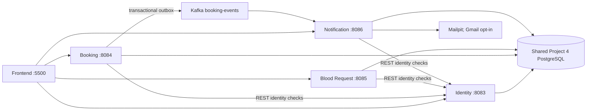
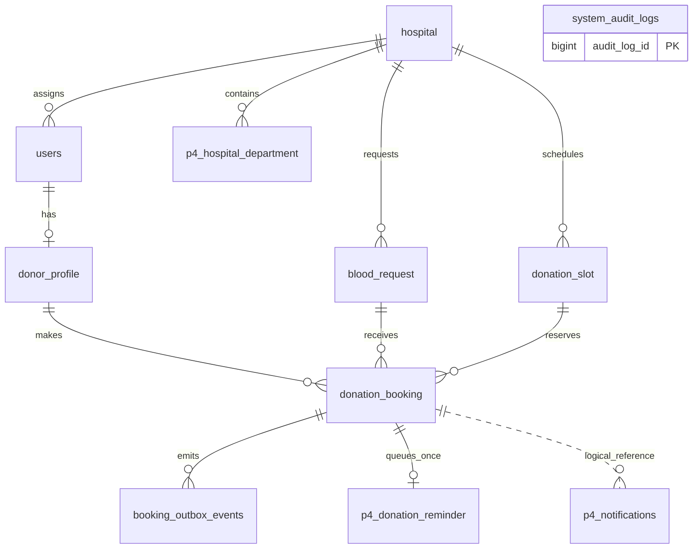

# Med Support Project 4

Project 4 continues the Project 2/3 blood-donation application with four Java 17 /
Spring Boot 4 services, Docker Compose, PostgreSQL 17 and Kafka. Project 3 source
and its root Compose configuration remain separate and unchanged.

## Architecture and data



| Service | Responsibility and primary tables |
|---|---|
| Identity | JWT, accounts, verification/reset, profiles, staff assignment; `users`, `donor_profile` |
| Booking | Appointments, slots, capacity, completion, reminders, outbox; `donation_booking`, `donation_slot`, `booking_outbox_events`, `p4_donation_reminder` |
| Blood Request | Hospitals, departments and request management; `hospital`, `blood_request`, `p4_hospital_department` |
| Notification | Own inbox, user-specific WebSocket, email retries; `p4_notifications` |

The database remains shared (`public` schema). Booking currently locks/updates
`blood_request`; Blood Request checks bookings before deletion; Identity checks
hospital existence for assignment. Three services write `system_audit_logs`.
These explicit couplings retain current atomicity; full database ownership
isolation and independently evolvable schemas are not claimed.



## Local configuration

Use `docker-compose.project4.yml` explicitly, with `runtime/project4/.env`.
Keep populated env files, backups and credentials out of Git. Required names:
`P4_DB_PASSWORD`, `P4_JWT_SECRET`, `P4_IDENTITY_SERVICE_KEY`,
`P4_NOTIFICATION_SERVICE_KEY`. Administrator bootstrap remains disabled normally;
its optional names are in `.env.example`. Never print rendered Compose env values.

PostgreSQL is **127.0.0.1:5434**, database `med_support`. Its dedicated volume is
`med-support-p4-local-postgres17-v1`; network is `med-support-p4-local-network-v1`.
Do not use occupied host ports 5432/5433, root Compose, volume removal or pruning.
The local DB bootstrap account is not a production least-privilege design.

Frontend: http://localhost:5500. CORS/WebSocket development origin is exactly that
origin, not 127.0.0.1. API URLs are public settings in `project4-frontend/config.js`.
All appointment date/time values currently use the server's UTC configuration.
Mailpit inbox: http://localhost:8025. No relay is configured. Keep the Gmail
Compose override omitted during tests; [GMAIL.md](GMAIL.md) explains opt-in SMTP.

## APIs, caching and monitoring

Each service serves `/v3/api-docs` and `/swagger-ui/index.html` on its own port.
Swagger declares bearer JWT and internal service-key authentication. Do not use
Try It Out to send production emails or mutate existing data during verification.
Kafka/WebSocket details are separate from REST docs.

Blood Request caches only hospital list/detail DTOs in local Caffeine caches:
maximum 200 entries, 60-second expiry, eviction after hospital mutations.
`HOSPITAL_CACHE_SPEC` can override the bounded policy. Multiple instances can
retain reference data until expiry. Authentication, slots, capacity and request
eligibility are never decided from this cache.

All four services expose `/actuator/health`, `/actuator/health/liveness` and
`/actuator/health/readiness` without internal details. Only health is publicly
exposed; env/config endpoints are not exposed. Mail health checks are disabled,
so inspection never attempts Gmail. Readiness reflects Spring readiness state;
use overall health for the configured dependency checks, and workflow checks for
business readiness. Existing Compose TCP checks remain local process checks.
Use `docker compose ... logs --tail 100 SERVICE` for failures; booking event IDs,
notification IDs, retries and outbox activity are logged. Never enable SMTP debug
or paste secrets/container environments into reports.

## Kafka and reliability

Booking writes the notification outbox in the same transaction as booking,
capacity and audit changes. The publisher sends to `booking-events`, keyed by
booking ID. Payload fields: `eventId, bookingId, recipientEmail, notificationType,
title, message`. Notification deduplicates event IDs, persists before email work,
and retries SMTP up to three attempts. Invalid events use `booking-events-dlt`.
Delivery is at least once, not exactly-once SMTP. Recovery is disabled by default;
review its existing settings/runbook before enabling it.

Reminder receipt and outbox insertion share one transaction. The receipt's booking
primary key prevents duplicate queueing. Already queued reminders cannot be
recalled after cancellation. The inbox always derives the recipient from Identity;
the WebSocket authenticates in its first frame and sends only that user's inbox.
See [frontend workflows](../../project4-frontend/README.md) and
[HTTP/event contracts](integration-tests/CONTRACTS.md).

## Tests and CI

```powershell
# Existing lightweight unit tests (no default-config application smoke contexts):
mvn -f identity-service/pom.xml '-Dtest=*Test' test
mvn -f booking-service/pom.xml '-Dtest=*Test' test
mvn -f blood-request-service/pom.xml '-Dtest=*Test' test
mvn -f notification-service/pom.xml '-Dtest=*Test' test
# Existing contracts plus three Cucumber scenarios; no external infrastructure:
mvn -f runtime/project4/integration-tests/pom.xml test
# Optional existing disposable PostgreSQL/Kafka concurrency gate:
mvn -f runtime/project4/integration-tests/pom.xml -Pintegration test
```

`integration-tests/Run-Baseline.ps1` wraps these commands and checks Docker before
`-Integration`. It accepts `-Maven` for a cached Maven executable. This is the only
integration harness. It uses no existing database, Compose volumes, env files or
Gmail. PostgreSQL refuses host port 5434; containers have allocated ports and no
reuse. The original five migrations run only inside its disposable fixture.

Retained tests cover last-slot races across two Booking contexts, terminal-status
races, closure/deletion races, atomic completion and rollback. Seven standalone
MVC checks protect booking/slot contracts. The existing event-contract class now
also holds three Cucumber scenarios: valid event processing, invalid event
rejection and unauthorized booking history. Persistence/Identity are mocked in
these lightweight scenarios; the existing Kafka test covers real transport.
No new JUnit suite or Testcontainers infrastructure was added.

`.github/workflows/project4.yml` checks frontend syntax, runs BDD/contracts and the
existing disposable concurrency gate, tests/packages four services, and builds
four Docker images. Push events publish commit-SHA tags to GHCR using the built-in
GitHub token. PRs build without publishing. No workflow has been run or images
published from this local change. AWS deployment/promotion remains pending.

## Manual activation and frontend acceptance

The existing five migrations must not be rerun. S005 is a forward-only MANUAL
upgrade and has not been applied by this work. Before activation, verify the host
port/database, confirm migration history and take a recoverable backup. If S005
already exists in the recorded history, do not rerun it. With PostgreSQL client
tools installed, these commands prompt privately for the dedicated DB password:

```powershell
$backupPath = Join-Path $env:TEMP 'project4-before-S005.dump'
pg_dump --host=127.0.0.1 --port=5434 --username=medsupport_p4 --dbname=med_support --password --format=custom --file=$backupPath
psql --host=127.0.0.1 --port=5434 --username=medsupport_p4 --dbname=med_support --password --set=ON_ERROR_STOP=1 --file=runtime/project4/S005__core_features.sql
# Only after the reviewed manual upgrade; Mailpit remains selected:
docker compose --env-file runtime/project4/.env -f docker-compose.project4.yml --profile runtime up -d --build --no-deps identity-service blood-request-service booking-service notification-service p4-frontend
```

Those are NEXT STEPS, not actions performed here. Recreating app containers does
not require stopping infrastructure or deleting volumes. Do not use `down -v`.

1. Check each service's health and Swagger URL; open http://localhost:5500.
2. Admin: create/activate a synthetic hospital; register staff, search users,
   assign that staff user to the hospital. Verify email through Mailpit. Check
   deactivate/reactivate on a synthetic donor/staff account and denied donor access
   to admin APIs. Administrator deactivation is protected.
3. Staff: sign in, create a department, request and future slot; review only their
   own hospital's bookings and confirm/complete one. Check automatic request
   completion when the required units are reached.
4. Donor: register/verify through Mailpit, upload a synthetic CPR file, create a
   donor profile, filter requests, select a slot, book and cancel an appointment.
   Check profile/password controls and Departments browsing.
5. Use a synthetic appointment less than 24 hours away; wait for the reminder
   poll. Verify its inbox/Mailpit notification appears once. Keep donor and staff
   sessions in separate browser profiles. Change status as staff and confirm the
   donor's Notifications screen updates through WebSocket. Verify another account
   cannot retrieve that inbox, and logout closes the socket.

Use synthetic records and Mailpit for these future manual steps. Browser acceptance,
new feature runtime checks, cache invalidation across instances, actual hosted CI
and deployment evidence remain to be recorded. None was claimed from compilation.

## Submission status and references

Keep the existing user stories/planning board current with migration, acceptance,
registry and AWS deployment evidence. Present the four service responsibilities,
transactional concurrency fix, Kafka flow, Cucumber scenarios, cache and pipeline.
Do not claim AWS deployment, strict database isolation or a production security
review before they are actually demonstrated.

References used: [Springdoc](https://springdoc.org/) for Boot 4/OpenAPI support;
[Cucumber JVM](https://cucumber.io/docs/installation/java/) for executable Gherkin;
[Spring Cache](https://docs.spring.io/spring-framework/reference/integration/cache.html)
for caching; [GitHub Actions](https://docs.github.com/actions) for CI/image workflow;
[PostgreSQL locking](https://www.postgresql.org/docs/current/explicit-locking.html)
for transaction/lock behavior. AI coding assistance was used for implementation,
cleanup and test preparation; the author must review and explain the submitted code.
